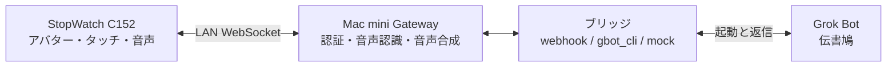

# GrokWatch

M5Stack StopWatch C152 を、Mac mini 上の既存 Grok Bot「伝書鳩」の顔・耳・口・タッチ画面にするプロジェクトです。StopWatch が丸型画面のアバターと日本語音声の入出力を担当し、伝書鳩が会話、記憶、Skills、タスク実行を担当します。

**v1.1.0 実装中（ビルドとモックのみ、実機未検証）**: 聞き取り中・考え中の表示強化、返事の感情に合わせた表情、「Hi Grok」ウェイクワード（既定は無効）。[v1.1.0 仕様](docs/V1_1_SPEC.md)

- [プロジェクト概要](docs/PROJECT_BRIEF.md)
- [先行実装の比較と採用案](docs/RESEARCH.md)
- [アーキテクチャ](docs/ARCHITECTURE.md)
- [アバター仕様](docs/AVATAR_SPEC.md)
- [セットアップ](docs/SETUP.md)・[書き込みと復旧の手順案](docs/FLASHING.md)・[テスト状況](docs/TEST_REPORT.md)

## 非公開 API 利用のリスク

GrokWatch 本体に非公開 API の呼び出しや Grok Bot アプリのセッション抽出を含めません。既定の候補は webhook ルーチンです。返信には別の経路が必要です。webhook と email トリガーは Grok Bot の機能説明に基づきます。公式文書の URL と実測は未確認です。

任意の `gbot_cli` アダプタは、利用者が自分で導入した第三者製 CLI を呼び出す案です。CLI は非公式かつアプリのセッションに依存します。アプリの更新による互換性の喪失や認証情報の取扱いにリスクがあるため、同梱せず、既定では無効とします。内部 RPC を使う native voice は実装しません。

## ライセンス

GrokWatch の自作部分は [MIT](LICENSE) です。現在、第三者コードの取り込みはありません。将来 BSL-1.0 由来のファイルを取り込む場合、そのファイルには BSL-1.0 が引き続き適用され、リポジトリには複数のライセンスが適用されます。Emotion Ball データを含む配布ファームには非商用条件が及びます。Apache-2.0 の再配布では、該当する NOTICE と帰属表示を保持します。 [第三者ライセンス](THIRD_PARTY_NOTICES.md)

## 参照動画

<https://x.com/sunlight3shine/status/2114645371347673376>
