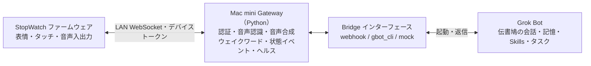
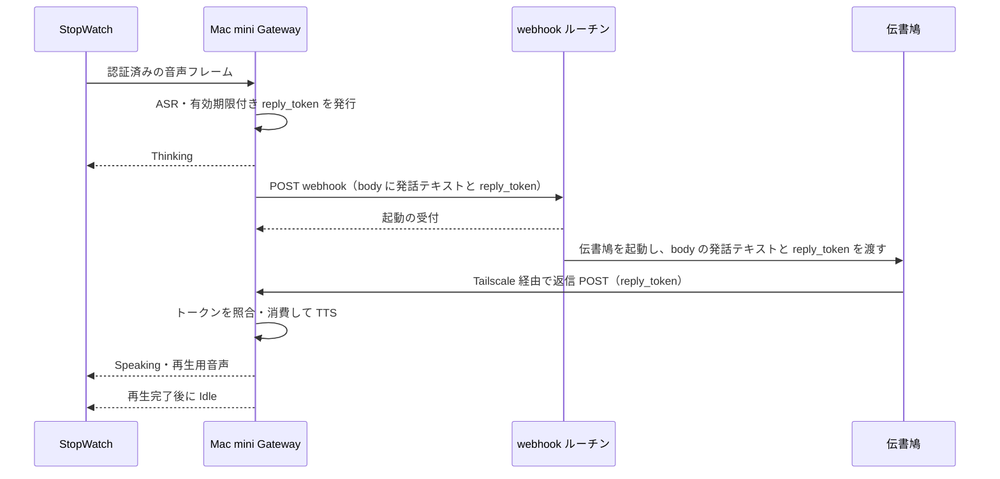

# アーキテクチャ案

端末は描画と入出力を担当する。ゲートウェイは「Hi Grok」、タッチによる起動、発話区間、音声処理、会話状態を管理する。伝書鳩は `GROKWATCH_AGENT_ID` で指定する。音声認識（ASR）は Mac mini ローカルの whisper.cpp / sherpa-onnx、音声合成（TTS）は macOS の `say` の日本語音声などを候補とし、Phase 3 で選定する。

## ブリッジの契約案

`GROKWATCH_BRIDGE` で `webhook`、`gbot_cli`、`mock` のいずれかを選ぶ。ゲートウェイはどのアダプタにも次の共通契約で発話を渡す。

| インターフェース | 契約 |
| --- | --- |
| `send_utterance(text, session) → reply stream` | 発話テキストとセッションを受け、返信テキストの断片と終了またはエラーを返す。webhook で一括取得した返信は一つの断片として扱える。 |
| `health()` | 現在のアダプタの設定と稼働状態を返す。起動や送信を伴わない確認を基本とし、認証情報を返さない。 |
| `cancel(session)` | セッションの返信待ちとローカル再生を終了する。外部ルーチンの停止ができない場合でも、以後の返信は採用しない。 |

| アダプタ | 役割 |
| --- | --- |
| `webhook` | 既定案。ルーチンを起動し、別経路で返信を受ける。 |
| `gbot_cli` | 任意案。利用者が自分で導入した第三者製 CLI を呼ぶ。非公式のセッション依存は外部ツール側にある。 |
| `mock` | テスト用。外部送信をせず固定応答、遅延、失敗を再現する。 |

## webhook の往復

webhook と email トリガーの根拠は Grok Bot の機能説明。公式文書の URL と実測は未確認。

返信受け口は、セッションにひも付く一回限りの `reply_token` を期限内に検証し、受理と同時に消費する。期限切れ、重複、取り消し後の返信は再生しない。送信キーは macOS Keychain から取得する。

ゲートウェイの返信受け口は既定で `127.0.0.1:8767` にバインドする。伝書鳩の実行環境から Tailscale 経由で返信を届ける方法と公開範囲は未決定。`tailscale serve` などの方法を Phase 3 で選ぶ。遅延は数秒〜数十秒の見込みで実測前。受信待ちの間は Thinking のアニメーションを続け、期限を過ぎたら Error に遷移する。

## デバイスとゲートウェイのメッセージ案

| 型 | 方向 | 内容 |
| --- | --- | --- |
| `hello/auth` | 端末 → ゲートウェイ、ゲートウェイ → 端末 | プロトコル版、デバイストークンと認証結果。認証前の他メッセージは処理しない。 |
| `audio frame` | 双方向 | 収音または再生音。コーデック、フレーム長、順序番号は Phase 3 で決める。 |
| `state` | ゲートウェイ → 端末 | 会話状態と遷移。端末は通信断を検出したら Disconnected を表示する。 |
| `touch event` | 端末 → ゲートウェイ | 会話開始など、ゲートウェイで処理するジェスチャー。視線追従は端末側で処理する。 |
| `error` | 双方向 | エラー種別と再試行可否。秘密を含まない診断コードを返す。 |
| `ping` | 双方向 | 疎通監視。タイムアウトで古い接続を閉じる。 |

Wi-Fi 切断またはゲートウェイ停止時は、待ち時間を 1 秒から指数的に増やし、最大 30 秒で再接続を続ける。復旧後は再認証し、Idle に戻す。切断前の未完了の音声セッションは破棄する。

ログには状態、エラー種別、遅延を残す。認証値、Agent ID、ローカル IP、家庭内パス、端末固有 ID は伏せる。音声や会話本文、認証ヘッダ、webhook URL は記録対象に含めない。 [ログ方針](../SECURITY.md)
